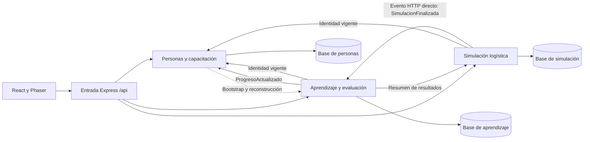

# Arquitectura actual — cierre técnico de la migración local

Actualizada al 21 de octubre de 2026. Para despliegue, herramientas y aceptación vigente, consultar [ESTADO-ACTUAL.md](ESTADO-ACTUAL.md).

La aplicación tiene tres microservicios Java por capacidades de negocio, con bases y credenciales independientes. React/Phaser conserva su contrato `/api`; Express continúa como entrada HTTP y composición de compatibilidad. El gateway independiente en `gateway/` está activo; el backend anterior quedó archivado en `legacy/backend`, sin workspace ni scripts habituales de arranque/escritura. No forma parte del runtime actual.

El envío directo de eventos se configura en el entorno local de fase 7. El puente anterior `/internal/events` de Express quedó en el archivo histórico. El gateway activo no registra esa ruta; el productor entrega directamente al Java de aprendizaje. No se publican rutas internas a través del proxy frontend. No hay recursión de identidad: `/auth/me` solo resuelve identidad y el resumen de simulación no consulta aprendizaje.

## Capacidades y capas

| Servicio | Capacidades | Datos propios |
|---|---|---|
| personas-capacitacion | identidad, usuarios, capacitacion | Cuentas, roles, sesiones/versiones, relaciones de equipo, grupos, miembros y hechos propios |
| aprendizaje-evaluacion | contenidos, evaluaciones, progreso | Módulos, lecciones, vídeos, desafíos, intentos, avance, logros e inbox |
| simulacion-logistica | escenarios, partidas | Escenarios, snapshots, decisiones, resultados y outbox de simulación |

Cada servicio y capacidad de negocio contiene `Application`, `domain` e `Infrastructure`. Son ocho capacidades: sus nombres expresan negocio antes que tecnología. Los directorios de adaptadores como HTTP o persistence no representan capacidades nuevas. Los puertos y casos de uso se mantienen en Application; las reglas y entidades en domain; Spring, JDBC, JSON, HTTP y composición en Infrastructure.

Los POM fijan bytecode Java 21. La regresión de fase 7 se ejecutó con JDK 22.0.2; posteriormente el usuario instaló Temurin 21.0.12.1 y compiló los tres servicios con 106 pruebas JUnit aprobadas. No se confunden ambas ejecuciones. Los ejecutables siguen en `0.1.0-SNAPSHOT`, sin release de producción acreditada. Cada servicio tiene Maven Wrapper y Flyway propios. Las reglas ArchUnit verifican separación de negocio/frameworks y ausencia de dependencias hacia implementaciones de otros servicios. Personas verifica además la separación de adaptadores entre sus capacidades.

## Datos y consistencia

Un solo propietario escribe cada conjunto de datos. Los identificadores externos no son FK entre servicios. Los tres roles locales no pueden conectarse a las otras bases Java; el borde no recibe credenciales SQL ni carga Prisma. Las herramientas Node de aprovisionamiento y pruebas conservan pg/bcrypt como dependencias de desarrollo, fuera del proceso HTTP. El contrato de propiedad es `contracts/propiedad-datos.json`.

La decisión de simulación, su resultado y su hecho se confirman en una transacción. El dispatcher reintenta y el inbox de aprendizaje deduplica por evento/simulación. Los informes inicializados leen people_progress_projections, propiedad derivada de personas. Aprendizaje transforma hechos en snapshots completos versionados ProgresoActualizado; su dispatcher confirma la cobertura de hechos después del 204 de personas. Hay inbox transaccional, leases, reintentos, bootstrap y reconstrucción. HTTP se conserva para esas operaciones y como modo de recuperación explícito. Los hechos de personas continúan en su outbox propio; no se afirma implementar consumidores adicionales de esos eventos. Véase [contrato y consistencia](../contracts/progreso-proyecciones-v1.md).

Las eliminaciones de contenido sin uso se realizan dentro de su propietario. Las FK restrictivas conservan intentos, progreso y partidas; un conflicto revierte los cambios anteriores de la transacción. No existe eliminación en cascada de historial de usuario desde el editor pedagógico.

## Límites actuales

Readiness comprueba la base propia; no certifica el estado de todas las dependencias. Una dependencia requerida por una operación devuelve 503 si está inaccesible. Los informes ya proyectados se sirven desde personas durante una caída de aprendizaje; un usuario sin proyección todavía necesita bootstrap y puede recibir 503. No hay fallback al backend archivado. La correlación del borde hacia personas está verificada; no se certifica trazabilidad distribuida completa.

Actuator y Micrometer exponen métricas con el perfil local `observabilidad`. Prometheus recoge los tres endpoints y Grafana dispone de un dashboard de ocho paneles; dos ensayos de caída/recuperación de simulación finalizaron con PASS. Son comprobaciones locales, no monitorización permanente ni alertas automáticas. En la auditoría del 21 de octubre Grafana y Prometheus no respondían, aunque los servicios Java sí estaban activos.

El frontend se publicó en Vercel, proyecto `stock-quest`, alias `https://stock-quest-five.vercel.app`. Sus peticiones `/api` pasan por una regla hacia el túnel Cloudflare y el gateway local 14600. Los tres servicios y sus bases siguen locales. El usuario validó los flujos de esta publicación temporal; no se trasladó la infraestructura completa a Vercel.

El entorno local usa secretos cifrados con Windows DPAPI y requiere el mismo usuario de Windows. El supervisor mantiene y controla sus procesos, pero no es un servicio de producción ni una garantía de autoarranque, recuperación automática o disponibilidad del 99 %. Las contraseñas tienen BCrypt; los campos personales se guardan sin cifrado de aplicación. Véase la matriz RF/RNF para estas brechas.

La entrada independiente está activada y el código anterior archivado con recuperación verificada. Los verificadores cubren 87 pruebas Node, 39 operaciones, eliminaciones protegidas y entrega de eventos sin el borde. AG-05 está implementado y activado, pendiente de validación humana; la retirada de bases y el paso a producción conservan sus puertas. Véase [activación y retirada](RETIRADA-LEGACY-20261021.md).
