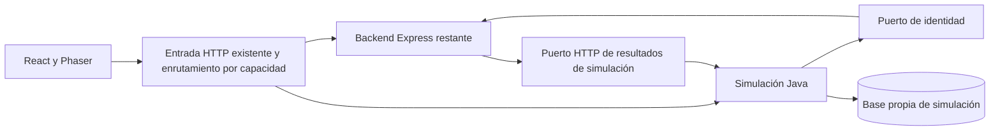
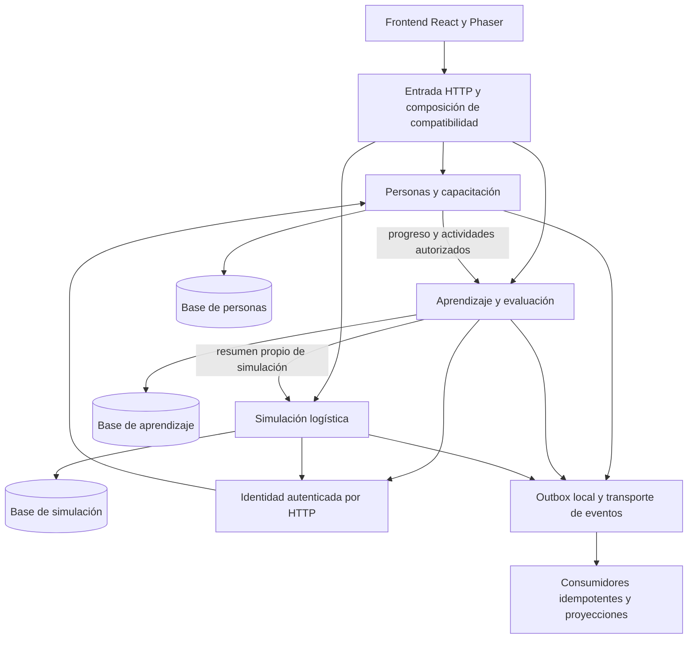

# Fase 3 — Diseño de la migración progresiva a Java

Estado: diseño aprobado expresamente por el usuario al autorizar la fase 4. Este documento conserva el diseño; la implementación y evidencias posteriores se registran en `FASE-4-IMPLEMENTACION.md`.

## Alcance y decisiones confirmadas

Se conserva React/Phaser y el contrato público `/api`. El backend se sustituirá progresivamente por tres procesos Java desplegables de forma independiente. No hay datos históricos que deban conservarse; no se borrará ninguna base existente. El usuario ejecutará personalmente las pruebas aisladas.

Referencia inspeccionada: commit `0547d891c06e6f0c7160ecb4cd0598d7cf0f1312` más la corrección local de `connectionOptions` documentada en la fase 2. No se confunden las verificaciones históricas con ejecuciones actuales. El documento Stock_Quest.docx y sus RF01–RF20/RNF01–RNF06 siguen siendo la referencia funcional.

Esta fase entrega diseño, contratos y verificación documental. No crea POM, servicios, bases, pipelines ni infraestructura. La configuración real de versiones y dependencias corresponde a fase 4. Jenkins, GitHub Actions, AWS CloudFormation y Grafana siguen en el plan posterior de entrega/operación; no se configuran ni despliegan aquí.

## Servicios y límites

| Servicio | Módulos y submódulos | Propietario de datos | Responsabilidad excluida |
|---|---|---|---|
| `personas-capacitacion` | `identidad` → `autenticacion`, `perfiles`; `capacitacion` → `empleados`, `grupos`, `seguimiento` | User, TrainingGroup, GroupMembership | Calcular notas, XP o consecuencias de simulación |
| `aprendizaje-evaluacion` | `aprendizaje` → `curriculo`, `lecciones`, `desafios`, `progreso` | Module, Lesson, Content, Challenge, ChallengeAttempt, LearningProgress, UserAchievement | Escribir partidas o decidir pertenencia a equipos |
| `simulacion-logistica` | `simulacion` → `escenarios`, `partidas` | SimulationScenario, Simulation, SimulationResult | Escribir logros o consultar tablas de usuarios |

El archivo `contracts/propiedad-datos.json` asigna cada uno de los 13 modelos Prisma actuales a un propietario. Los IDs externos son referencias opacas; no hay FK ni consultas SQL entre bases de servicios. Las proyecciones son datos derivados reconstruibles y nunca se convierten en otra fuente de verdad.

Un repositorio Git compartido no exige desplegar todo junto. Cada servicio tendrá POM, ejecutable, configuración, credenciales y ciclo de migraciones independientes. Se propone PostgreSQL 16 para mantener la referencia actual, inicialmente con bases lógicas y usuarios separados en una misma instancia de desarrollo si resulta útil. No se comparte usuario de escritura.

## Arquitectura de transición



El diagrama representa el primer servicio extraído, no el estado actual. La fase 4 construye un corte de desarrollo sin cambiar aún el enrutamiento público. La fase 5A habilita el servicio solo después de completar sus dependencias y adaptar los consumidores.

## Arquitectura objetivo



Las flechas HTTP representan lecturas y validación de identidad, no acceso a bases ajenas. Para evitar ciclos de llamadas: `/auth/me` solo resuelve identidad; el resumen de simulación no consulta aprendizaje; el progreso no consulta informes de personas. Los eventos no sustituyen la autorización vigente.

## Organización hexagonal y cortes verticales

```text
services/
  simulacion-logistica/
    pom.xml
    mvnw.cmd
    .mvn/wrapper/
    src/main/java/com/stockquest/
      simulacion/
        Application/                 # Contratos públicos de la capacidad
        domain/                      # Conceptos compartidos dentro del módulo
        Infrastructure/              # Composición del módulo
        escenarios/
          Application/
          domain/
          Infrastructure/
        partidas/
          Application/
            RegistrarDecision.java
            ports/
          domain/
            Partida.java
            MotorInventario.java
          Infrastructure/
            http/
            persistence/
            identity/
    src/test/java/com/stockquest/
```

El mismo patrón se aplica a cada módulo y submódulo de la tabla de servicios. `services`, `src`, `ports`, `http` y `persistence` son agrupaciones técnicas, no nuevos submódulos de negocio. Cada caso de uso es una clase o conjunto pequeño de clases, sin multiplicar carpetas por obligación.

Se respeta literalmente `Application`, `domain`, `Infrastructure`. Implica paquetes Java con esa capitalización; se prioriza la estructura solicitada frente a la convención habitual de minúsculas. No se usarán variantes que difieran solo por mayúsculas en Windows.

Reglas de dependencia:

1. `domain` no importa Spring, JPA, JDBC, HTTP, Jackson ni clases de infraestructura.
2. `Application` usa dominio y define puertos; no ejecuta SQL ni depende de controladores.
3. `Infrastructure` implementa puertos y adapta HTTP, persistencia, identidad y mensajes.
4. Un submódulo consume el contrato público de otro, no su repositorio ni entidad de persistencia.
5. Los conceptos compartidos del módulo se definen una vez. No hay una biblioteca de entidades de negocio compartida entre servicios.
6. Las anotaciones de framework y el ensamblado quedan fuera del dominio. La entrada ejecutable puede situarse en infraestructura del módulo raíz para descubrir sus componentes explícitamente.

## Primer corte de fase 4

Capacidad: registrar una decisión en una partida y devolver su estado evaluado.

| Elemento | Diseño |
|---|---|
| Entrada | `POST /api/simulations/{id}/decisions`, mismo JSON y DTO actual |
| Caso de uso | `RegistrarDecision` en `partidas/Application` |
| Dominio | Partida, snapshot de escenario, decisión, evaluación, día y cantidad |
| Puertos | PartidaRepository, IdentidadActual, UnidadDeTrabajo, Outbox |
| Adaptadores | HTTP, PostgreSQL, consulta `/auth/me`, outbox SQL |
| Concurrencia | UPDATE condicional por id, userId y día; conflicto devuelve 409 |
| Transacción | Decisión, día, resultado final y evento de cierre confirmados juntos |
| Preparación | Inicio/consulta mínimos de partidas con escenario de desarrollo propio; no leer tablas del monolito |

La prueba inicial del caso de uso puede usar repositorios en memoria, pero el corte se presenta como completo solo cuando su adaptador de persistencia esté implementado y exista un procedimiento de validación de integración para el usuario. No se presenta un mock como servicio listo para producción.

Paridad del motor: el pedido del día 1 con leadTime 2 llega al inicio del día 3; los faltantes son ventas perdidas; se cobran pedidos aunque lleguen fuera del horizonte; no se liquida stock final. Se preservan fórmula de score, umbrales y textos. Cambiar esas reglas requiere decisión separada.

## Contratos y compatibilidad

`contracts/openapi-compatibilidad.json` inventaría las rutas actuales y sus DTO relevantes. Cada operación registra propietario, roles y referencia de implementación. No representa endpoints Java ya implementados ni una validación de ejecución.

Las respuestas conservan nombres JSON, códigos de éxito, roles y reglas actuales. Se documentan explícitamente respuestas de creación/edición que no tienen la misma forma que una consulta. Los errores mantienen `{message, issues?}`. Se añade 503 como comportamiento propuesto para dependencia no disponible: nunca transformar ese fallo en credenciales inválidas, progreso cero o datos vacíos.

Dos consultas necesitan composición:

- `GET /api/admin`: aprendizaje aporta módulos completos del gestor y simulación aporta todos sus escenarios, incluidos no publicados. No reutilizar la lista pública de escenarios para esta composición.
- `GET /api/reports` y `/{id}`: personas comprueba pertenencia al líder y compone progreso/actividades desde aprendizaje. Simulación aporta la contribución a XP y aprobación mediante un contrato de lectura.

La composición de `/admin` será un adaptador de compatibilidad en la entrada existente; no constituye un cuarto microservicio de negocio. Timeout por destino y fallo 503 si falta una parte: no devolver un objeto parcial con 200.

## Identidad y consistencia

Para preservar revocación inmediata entre peticiones, el primer adaptador Java consulta `/api/auth/me` del propietario de identidad con el Bearer recibido. Ese endpoint ya comprueba firma, active, rol y tokenVersion. Java no necesita compartir el secreto HS256 ni leer User.

Mientras identidad vive en Express se consulta Express; tras 5C se consulta personas Java. Sin caché positiva de identidad en esta etapa. Timeout o propietario indisponible produce 503 y no autoriza. Las operaciones ya iniciadas antes de una revocación mantienen la misma limitación temporal que la implementación actual. Una futura validación JWT autónoma requiere diseñar y aprobar su política de revocación; no se incorpora silenciosamente.

El progreso actual se recalcula inmediatamente. Para no degradarlo a una proyección atrasada, `/progress` e informes consultarán un resumen de simulaciones confirmadas por HTTP autenticado. Outbox/eventos mantendrán proyecciones auxiliares y logros idempotentes. La clave `PRIMERA_SIMULACION` puede derivarse del primer resultado en esa misma lectura hasta que el consumidor la persista; no se concede ni suma dos veces.

`contracts/eventos-v1.schema.json` define sobres y payloads mínimos. Los eventos son hechos confirmados; la entrega es al menos una vez. Outbox se confirma con la transacción local, inbox con el cambio del consumidor y un índice único por consumidor/eventId. El transporte podrá cambiar sin cambiar el dominio. No se incorpora Kafka ni un broker nuevo en fase 3.

## Trazabilidad funcional

| Requisitos | Servicio o composición | Validación prevista |
|---|---|---|
| RF01–RF04 | Personas e interfaz | Registro, login, roles y redirección |
| RF05, RF07, RF10, RF11 | Aprendizaje e interfaz | Ruta, repaso, secuencia, texto y YouTube |
| RF06, RF08, RF09 | Simulación e interfaz | Interacción 2D, reporte y feedback |
| RF12–RF14 | Aprendizaje con lectura de simulación | Persistencia, refuerzo y porcentajes |
| RF15, RF16 | Aprendizaje y composición `/admin` | Acceso pedagógico y cambios de contenido |
| RF17 | Simulación y composición `/admin` | Parametrización y snapshots |
| RF18–RF20 | Personas con lectura de aprendizaje | Informes, grupos y colaboradores |
| RNF01 | Transversal | Carga a 10 Mbps, composición acotada y mediciones reales |
| RNF02 | Frontend preservado | Evaluación con usuarios; no se acredita por arquitectura |
| RNF03 | Operación futura | Ventana de disponibilidad y recuperación acordadas |
| RNF04 | Personas e infraestructura de todos | Hash, permisos y política de cifrado de datos |
| RNF05 | Frontend y API | Matriz de navegadores y móvil |
| RNF06 | Frontend y errores compatibles | Confirmaciones y errores visibles |

Las brechas de tarjetas de repaso, reporte financiero, videos definitivos y vinculación de autorregistrados no se declaran resueltas por mover código. Se registrarán como entregas explícitas; la vinculación requerirá invitación/aceptación o procedimiento autorizado, no búsqueda y apropiación por correo. IA externa queda fuera hasta contar con requisito y aceptación definidos.

## Revisión y gate

Leer junto con `arquitectura/DECISIONES-FASE-3.md`, `arquitectura/TRANSICION-Y-VALIDACION.md` y `contracts/README.md`.

Antes de fase 4 el usuario valida: tres límites, Java 21 como objetivo propuesto, estructura literal, compatibilidad HTTP, primer corte, propiedad de datos y pruebas pendientes a su cargo. La selección concreta de Spring Boot, JUnit y Maven se fijará al preparar el servicio, usando versiones estables compatibles y reproducibles. Esta fase no instala otro JDK.
